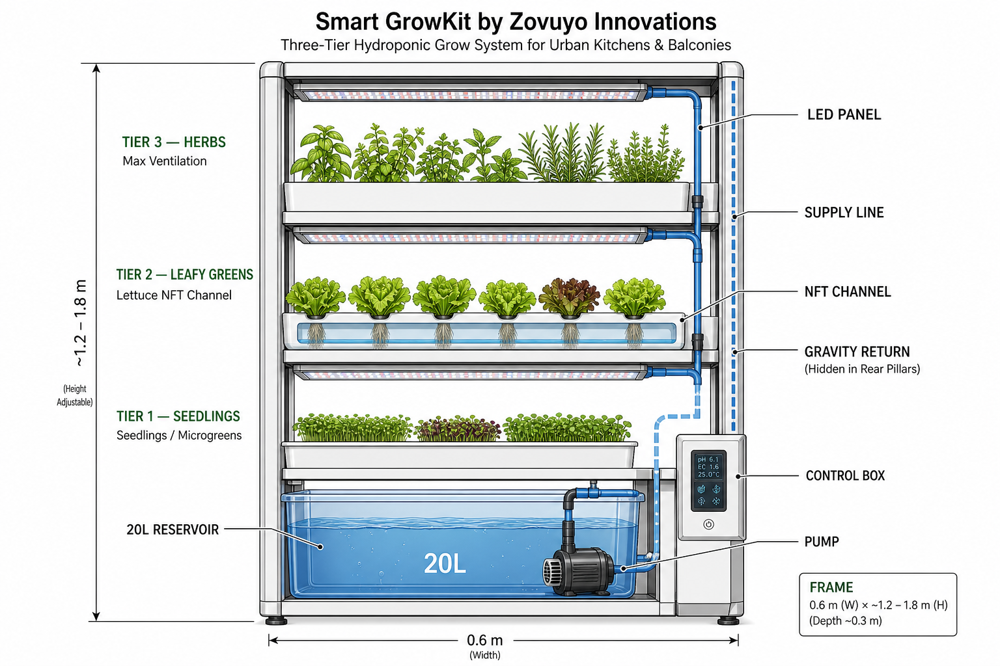
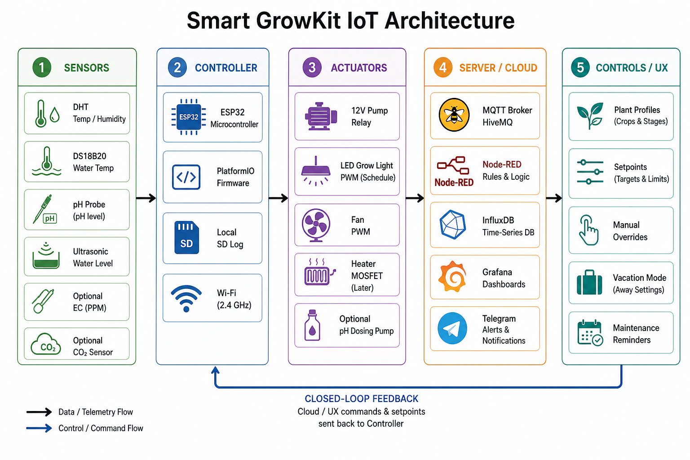
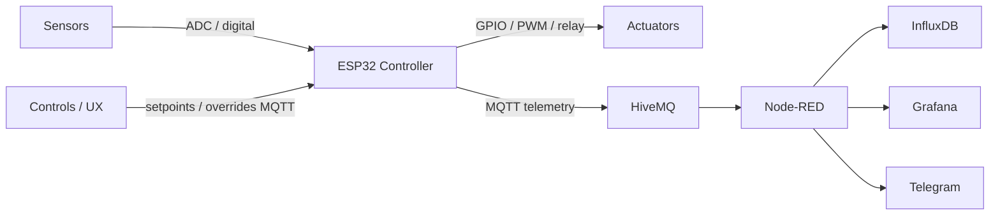
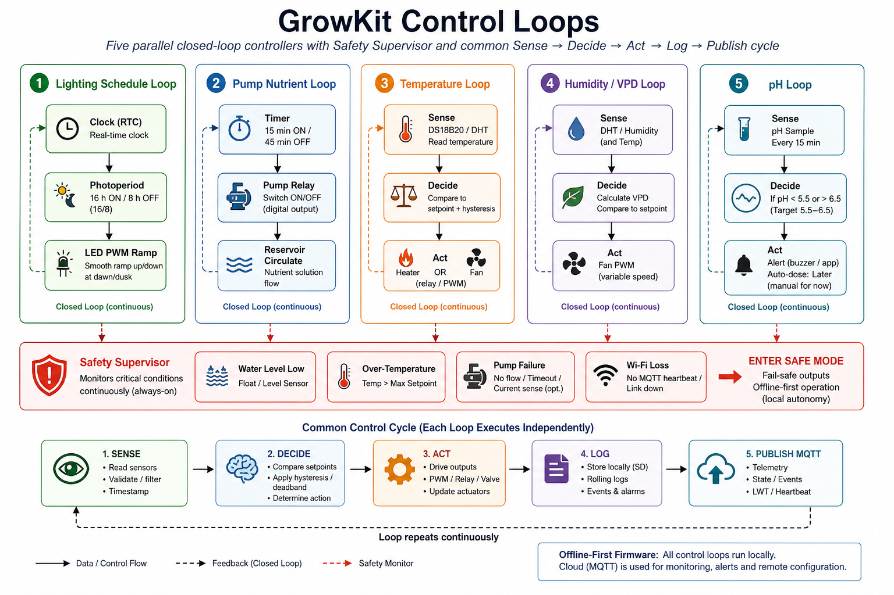

# Zovuyo Innovations — Smart GrowKit
## Living Architecture & Team Lead Document

| Field | Value |
| --- | --- |
| Product | **Smart GrowKit** (home / balcony / kitchen hydroponic appliance) |
| Company | Zovuyo Innovations |
| Status | Funded · trademarking in progress · Innovate Durban incubatee |
| Document owner | Oluhle Jawe (Founder) |
| Version | **0.1 — Living draft** |
| Date | 7 September 2026 |
| Audience | Mechanical / structural, electronics, firmware, cloud, and product advisors |

> **How to use this document**  
> This is the single source of truth for incoming engineering teams. Update the *Decision log* when something is locked. Do not invent a second product story — greenhouse / Greenspace farmer systems are **phase two**, not the first ship.

---

## 1. Product north star

Smart GrowKit is a compact, IoT-controlled **three-layer hydroponic** unit for urban South African households. It circulates nutrient solution to three plant beds, keeps environment in range for leafy greens and herbs, and reports health to the cloud — while remaining **offline-first** so plants survive Wi-Fi loss and load shedding.

**Commercial targets (locked for demo MVP unless changed in Decision log)**

| Item | Demo default |
| --- | --- |
| Form | Vertical 3-tier unit |
| Footprint | ≈ 0.6 m width × 0.4 m depth |
| Height | Target envelope **1.2–1.8 m** (three beds need height; kitchen-fit variants may shrink later) |
| Reservoir | **20 L** nutrient tank at base |
| Pump cycle | **15 min ON / 45 min OFF** |
| Retail ambition | R5,000–R8,000 class (BOM still incomplete) |
| Controller | ESP32 (PlatformIO / Arduino framework) |
| Cloud (demo) | MQTT (HiveMQ) → Node-RED → InfluxDB → Grafana + Telegram |

**Out of scope for first ship:** farmer walk-in greenhouses, blockchain subscriptions, full mobile app store release, NRCS certification (plan for later), auto pH dosing hardware (alert + manual first).

---

## 2. Team map (who owns what)

| Team / lane | Owns | Primary artefacts |
| --- | --- | --- |
| **A — Structure & hydro** | Frame, beds, NFT/channels, plumbing, reservoir, LEDs mount, enclosure IP | This §3, CAD, BOM mechanical |
| **B — Power & electronics** | PSU, fuse, bucks, star ground, relays, MOSFET, connectors, control box | Schematics, PCB/proto, §4–5 |
| **C — Firmware** | ESP32 loops, sensors drivers, safe mode, MQTT publish | PlatformIO repo, §6–7 |
| **D — Cloud & UX** | Broker, Node-RED rules, Influx/Grafana, Telegram, later app | Stack diagram §5, dashboards |
| **E — Product / compliance** | Branding (Zovuyo / GrowKit), POPIA, SANS/NRCS roadmap, demo script | Decision log, risk register |

---

## 3. Structure — three hydroponic layers

### 3.1 Concept

Three isolated plant beds stacked vertically. A single reservoir and pump feed **up** to the top; solution cascades **down** (gravity return) so each bed receives nutrients without three separate pumps in MVP.

| Tier | Role | Typical crop | Notes |
| --- | --- | --- | --- |
| **Tier 3 (top)** | Max ventilation | Basil, mint, soft herbs | Warmest / most airflow |
| **Tier 2 (middle)** | Main production | Butterhead / romaine (NFT channel) | Primary demo bed |
| **Tier 1 (bottom)** | Nursery | Seedlings / microgreens | Lower light spill; protected |

Under each upper shelf: **full-spectrum LED panel** for that bed’s photoperiod.

### 3.2 Labelled structure drawing



### 3.3 Plumbing logic (MVP)

```text
[20L Reservoir] --pump--> Supply riser --> Tier 3 bed
                                      --> Tier 2 bed (branch or cascade)
                                      --> Tier 1 bed
Tier drains --> Gravity return (rear pillars) --> Reservoir
```

**MVP choice:** one pump, shared nutrient recipe, shared pH/EC sensing in the **reservoir** (not per-bed probes). Per-bed valves / EC are a later SKU upgrade.

### 3.4 Mechanical checklist for Structure team

- [ ] Frame material & joinery (powder-coat aluminium / treated timber) — stable with wet 20 L base  
- [ ] Bed type per tier (NFT channel vs deep-water tray) locked in CAD  
- [ ] Leak paths, drip loops, drip tray under reservoir  
- [ ] Cable glands on **bottom** of control box; DIN rail for relays  
- [ ] Service access: front for plants, side for reservoir fill, box without full strip-down  
- [ ] Noise target <40 dB @ 1 m; wet weight target documented  

---

## 4. IoT architecture — sensors → actuators → controller → server → controls

### 4.1 Layer diagram



### 4.2 Layer definitions (use these names in all team docs)

| Layer | What it is | Demo MVP contents |
| --- | --- | --- |
| **1. Sensors** | Measure world | DHT (air T/RH), DS18B20 (water T), pH probe, ultrasonic / float (level). Optional later: EC, CO₂ |
| **2. Controller** | Local brain | ESP32, PlatformIO firmware, RTC/time, local SD log, Wi-Fi 2.4 GHz |
| **3. Actuators** | Change world | 12 V pump via relay, LED PWM schedule, fan PWM. Later: heater MOSFET, pH dose pumps |
| **4. Server / cloud** | Store & decide remotely | HiveMQ MQTT, Node-RED, InfluxDB, Grafana, Telegram |
| **5. Controls / UX** | Humans & policies | Plant profiles, setpoints, manual override, vacation mode, maintenance reminders |

**Hard rule:** Layers 1–3 must keep plants alive with **cloud offline**. Layer 4–5 are observability and remote config — not the primary control path.

### 4.3 Data / command flow



### 4.4 Pin / interface ownership (draft — Firmware + Electronics to finalise)

| Function | Interface class | Notes |
| --- | --- | --- |
| Air T/RH | Digital 1-wire / DHT pin | Prefer DHT22 over DHT11 for demo accuracy |
| Water T | DS18B20 1-wire | In reservoir |
| pH | Analog via isolator / ADS1115 | Calibrate 4.0 / 7.0 buffers |
| Level | Ultrasonic UART/TRIG-ECHO or float | Alert <20% |
| Pump | Relay (low-side) 12 V | Never mains-switched pump on MVP |
| LED | MOSFET / PWM dimmer 12 V | Soft ramp dawn/dusk |
| Fan | PWM (driver or MOSFET) | Humidity / temp assist |
| Heater | MOSFET + fuse + flyback | Only after critical parts in BOM |

---

## 5. Power & safety (Electronics lane)

Locked engineering intent from design baseline:

- Supply: size for peak load with headroom (design notes used 12 V class; electrical pack also shows 24 V front-end — **Decision log must pick one rail for MVP**)  
- Master **10 A ceramic fast-blow fuse** before full build power-up  
- Buck cascade for logic rails; **star grounding** (no heater ground daisy-chained through ESP32)  
- Flyback diodes on inductive loads; XT60/XT30 for high current; GX12 for sensors  
- Water near SELV only; IP-minded enclosure; RCD on mains PSU inlet  

**Do not energise full system** without fuse + flyback diodes fitted.

---

## 6. Control-loop algorithms (Firmware lane)

Advisor note: architecture/control-loop **patterns** may be studied from public IoT garden projects; **do not copy** third-party source without a licence. GrowKit loops below are specified clean-room for hydroponics.

### 6.1 Overview drawing



### 6.2 Common cycle (every loop)

1. **SENSE** — read, filter (median / EMA), timestamp, sanity-check  
2. **DECIDE** — compare to setpoint with hysteresis / deadband  
3. **ACT** — drive GPIO/PWM/relay; rate-limit changes  
4. **LOG** — local SD / ring buffer (survive outages)  
5. **PUBLISH** — MQTT topic JSON (non-blocking; queue if offline)

### 6.3 Loop catalogue

#### Loop L1 — Lighting schedule
- **Inputs:** RTC / NTP time, plant profile photoperiod (default 16 h ON / 8 h OFF)  
- **Outputs:** LED PWM  
- **Logic:** Soft ramp 20–30 min at dawn/dusk; never exceed profile intensity  
- **Fail-safe:** If RTC lost, fall back to last known schedule or fixed 16/8 from boot millis once NTP restored  

#### Loop L2 — Pump / nutrient circulation
- **Inputs:** Timer, water-level OK flag, leak/fault flags  
- **Outputs:** Pump relay  
- **Logic:** 15 ON / 45 OFF while level ≥ threshold; skip ON if level low or fault  
- **Fail-safe:** Pump forced OFF on low level; alert  

#### Loop L3 — Temperature
- **Inputs:** Water T (DS18B20), air T (DHT), day/night setpoints  
- **Outputs:** Fan ↑, heater (when enabled)  
- **Logic:** If T > setpoint + hysteresis → cool (fan); if T < setpoint − hysteresis → heat  
- **Fail-safe:** Hard over-temp cutoff (heater OFF, fan max, critical alert)  

#### Loop L4 — Humidity / airflow
- **Inputs:** RH, air T (optional VPD estimate)  
- **Outputs:** Fan PWM  
- **Logic:** Raise fan when RH high or VPD low for leafy greens vegetative targets  
- **Fail-safe:** Cap fan noise at night if profile allows  

#### Loop L5 — pH (MVP = sense + alert)
- **Inputs:** pH every 15 min  
- **Outputs:** Alert; later dosing pumps  
- **Logic:** Target 5.8 ± 0.2 (band 5.5–6.5). Out of band → Telegram / local alarm; **no auto-dose until dosing hardware + delay interlock exists**  
- **Fail-safe:** Ignore wild readings until recalibration flag cleared  

### 6.4 Safety supervisor (always on)

Triggers **SAFE MODE**: pump OFF (or minimal survival pulse only if explicitly designed), heater OFF, LEDs optional dim, fan as needed for heat, local beep, MQTT alarm retained.

| Trigger | Action |
| --- | --- |
| Reservoir < 20% | Pump inhibit + alert |
| Over-temperature | Heater kill + fan max |
| Sensor disconnect | Hold last safe actuator state + alert |
| Wi-Fi / MQTT loss | Continue local loops; queue telemetry |
| Power brown-out | Orderly GPIO safe defaults |

### 6.5 Pseudocode (reference for Firmware team)

```text
every tick:
  safety.evaluate()
  if safety.safe_mode: apply_safe_outputs(); publish_alarm(); return

  L1_lighting.tick()
  L2_pump.tick()
  L3_temperature.tick()
  L4_humidity.tick()
  L5_ph.tick()   # sense/alert only in MVP

  if due(telemetry_period):
    mqtt.publish(snapshot_json())
  if due(local_log_period):
    sd.append(snapshot_csv())
```

### 6.6 Example MQTT telemetry (contract for Cloud team)

```json
{
  "deviceId": "growkit-001",
  "ts": "2026-09-07T12:00:00+02:00",
  "tierProfile": "leafy-veg",
  "airTempC": 22.4,
  "humidityRh": 63,
  "waterTempC": 20.1,
  "ph": 5.9,
  "levelPct": 72,
  "pump": "on",
  "ledPwm": 80,
  "fanPwm": 50,
  "safeMode": false
}
```

Topics (proposed): `growkit/{deviceId}/telemetry`, `growkit/{deviceId}/events`, `growkit/{deviceId}/cmd`.

---

## 7. Demo MVP build sequence (shared roadmap)

1. USB serial driver → flash blink on ESP32 (unblock firmware)  
2. Order critical missing parts (fuse, flyback diodes, MOSFET)  
3. Bring up sensors **one at a time** (T/RH → level → pH → …)  
4. Bench-test relays on dummy load — never first-test on heater  
5. Implement L1–L5 + safety supervisor  
6. Stand up MQTT → Node-RED → Influx → Grafana → Telegram  
7. Integrate on three-tier wet rig with leak watch  
8. 72 h soak + simulated load-shedding test  

---

## 8. Reference posture (IP & pattern use)

Public projects (e.g. ESP32 garden demos) may inspire **documentation clarity** and **control-loop organisation**. Zovuyo firmware, CAD, brand, and cloud configs are **original**. Do not paste third-party source into commercial repos without a written licence. Do not commit secrets or device certificates to git.

---

## 9. Open decisions (resolve in Decision log)

| ID | Question | Options / notes | Owner |
| --- | --- | --- | --- |
| D1 | Exact height for first prototype | 1.2 m kitchen vs taller 1.5–1.8 m three-bed demo | Structure |
| D2 | Primary DC rail | 12 V vs 24 V front-end from electrical pack | Electronics |
| D3 | Bed tech per tier | All NFT vs mixed tray/NFT | Structure |
| D4 | Brand mark for demo UI | Zovuyo / Smart GrowKit (not Greenspace) | Product |
| D5 | EC & CO₂ on demo unit? | Optional; not required for first wet demo | Firmware/Product |

---

## 10. Decision log

| Date | Decision | Decided by |
| --- | --- | --- |
| 2026-09-07 | Primary product = home Smart GrowKit; greenhouse later | Oluhle |
| 2026-09-07 | Demo defaults: 20 L reservoir, 15/45 pump, ESP32, free-tier MQTT stack | Working baseline |
| 2026-09-07 | Physical intent = **three stacked beds** with shared nutrient delivery | Oluhle |

---

## 11. Asset index

| File | Description |
| --- | --- |
| `assets/01-structure-3tier.png` | Labelled three-tier structure |
| `assets/02-iot-architecture.png` | Sensors → … → Controls |
| `assets/03-control-loops.png` | Control-loop + safety supervisor |

---

*End of living draft v0.1 — update version number on each material change.*
